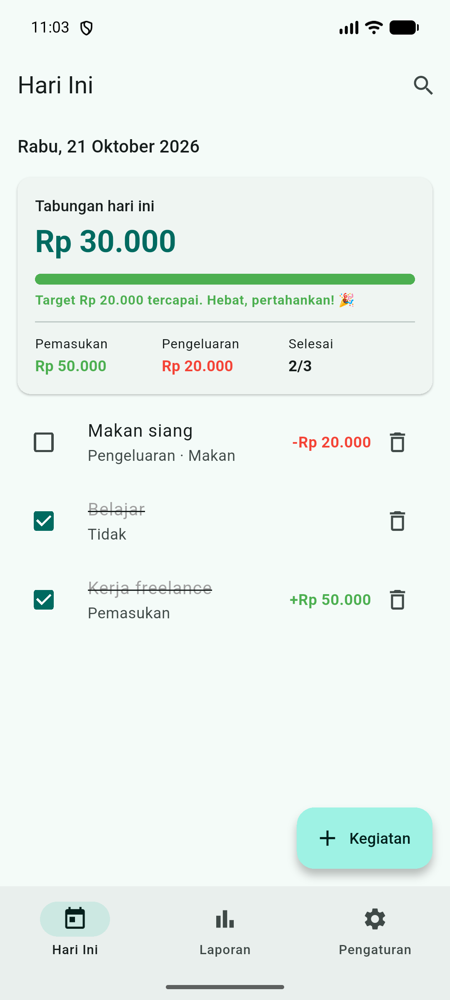
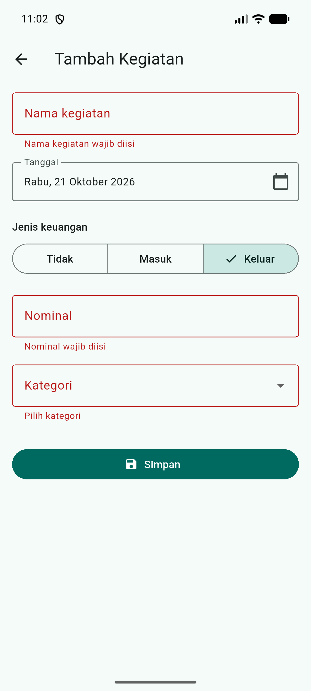
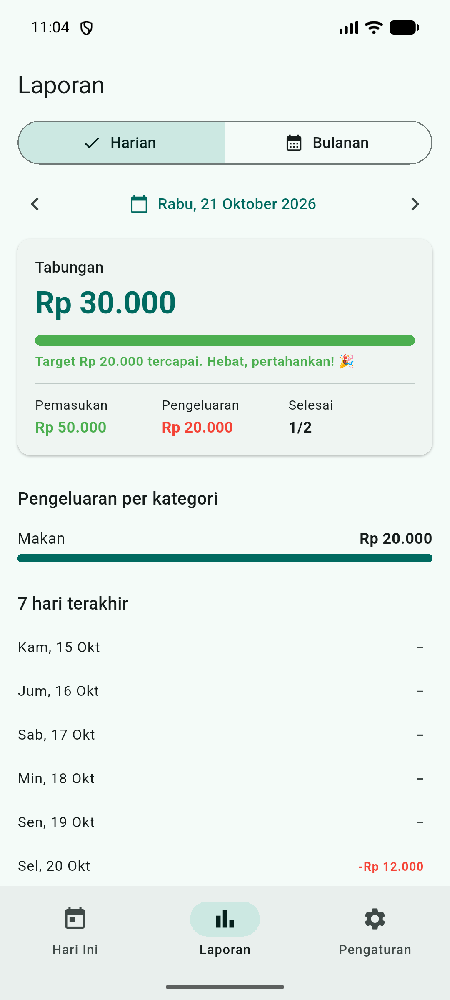
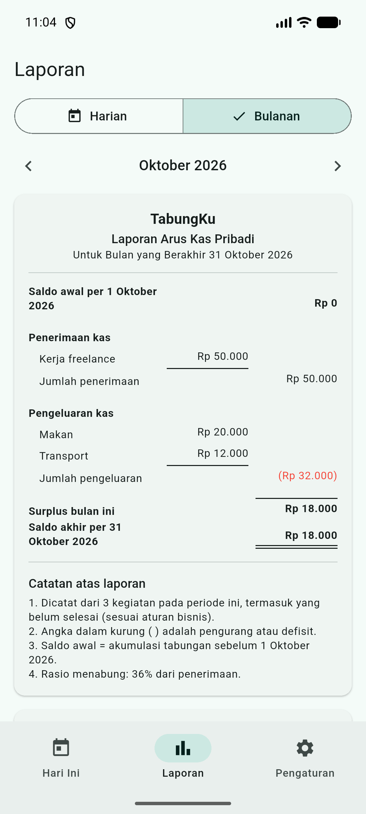
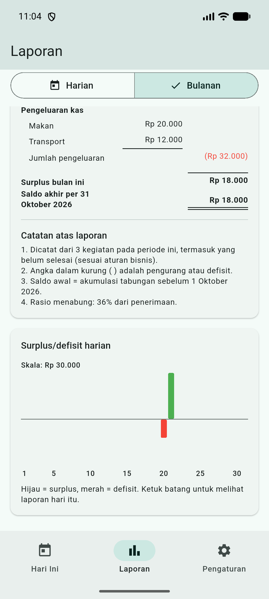
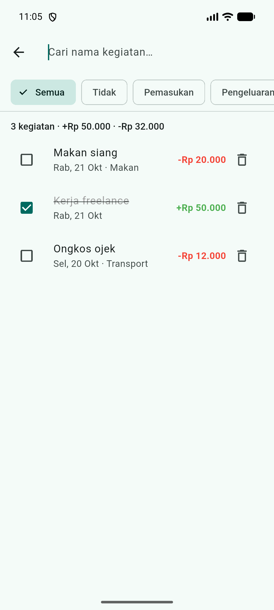
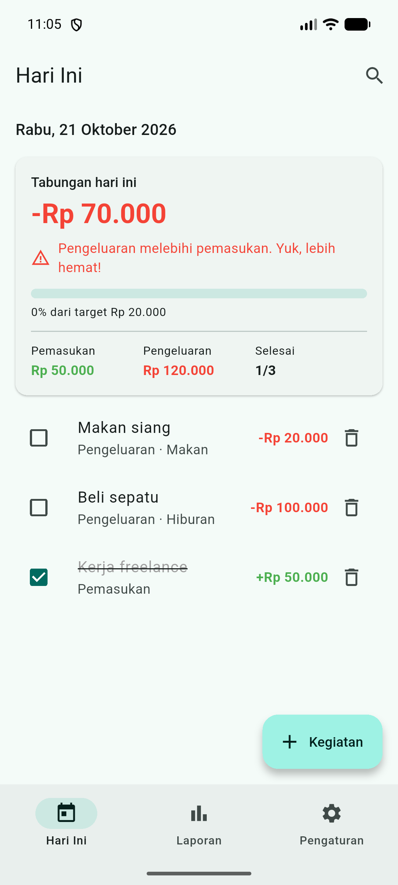
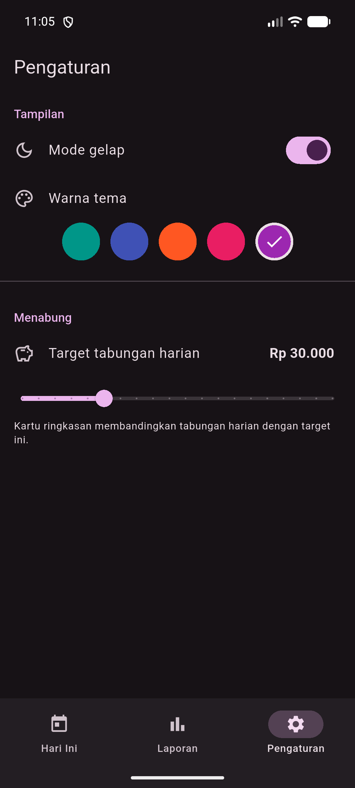
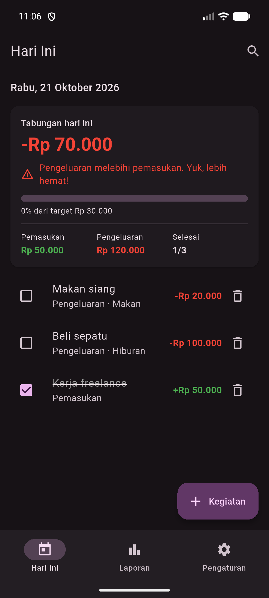

# TabungKu

Mini proyek Pertemuan 7 Praktikum Flutter Fundamental: aplikasi **to-do list + manajemen keuangan** untuk melatih kebiasaan menabung.

Setiap kegiatan harian dicatat bersama jenis keuangannya (tidak melibatkan uang, pemasukan, atau pengeluaran berkategori). Aplikasi lalu meringkasnya menjadi laporan harian dan bulanan, dan membandingkan tabungan hari itu dengan target menabung.

## Daftar Fitur

### Fitur wajib

| Kode | Fitur | Lokasi |
|---|---|---|
| F1 | Daftar kegiatan hari ini: centang selesai, ubah (ketuk), hapus dengan konfirmasi | `pages/beranda_page.dart`, `widgets/kegiatan_tile.dart` |
| F2 | Form tambah/ubah: nama, tanggal (date picker), jenis keuangan, nominal, kategori, semuanya tervalidasi | `pages/form_kegiatan_page.dart` |
| F3 | Penyimpanan SQLite (tabel `kegiatan`) | `data/db_helper.dart` |
| F4 | Kartu ringkasan hari ini: jumlah selesai/total, pemasukan, pengeluaran, tabungan | `widgets/ringkasan_card.dart` |
| F5 | Laporan: pilih tanggal, ringkasan, pengeluaran per kategori, 7 hari terakhir | `pages/laporan_page.dart` |
| F6 | Target tabungan harian + progress beranimasi, peringatan bila minus, apresiasi bila tercapai | `widgets/ringkasan_card.dart` |
| F7 | Pengaturan mode gelap, warna tema, target (shared_preferences) | `pages/pengaturan_page.dart`, `state/pengaturan.dart` |
| F8 | NavigationBar 3 tab + named route `/form` dan `/cari` | `pages/shell_page.dart`, `main.dart` |

### Aturan bisnis

- Tabungan harian = total pemasukan − total pengeluaran dari **semua** kegiatan pada tanggal itu, baik yang sudah maupun belum selesai.
- Nominal wajib berupa angka > 0 untuk pemasukan/pengeluaran. Untuk jenis "Tidak", nominal disimpan 0 dan kategori `-`.
- Kategori pengeluaran: Makan, Transport, Belajar, Hiburan, Lainnya.
- Target bawaan Rp 20.000 (dapat diatur Rp 5.000–Rp 100.000) dan tetap tersimpan setelah aplikasi ditutup.

## Fitur Pengembangan Lanjutan yang Dipilih

1. **Laporan bulanan + grafik batang** (`widgets/laporan_bulanan.dart`, `widgets/grafik_batang.dart`)
   - Disajikan sebagai **Laporan Arus Kas Pribadi** mengikuti kaidah penyajian akuntansi:
     - kepala laporan 3 baris (entitas, nama laporan, periode);
     - saldo awal → penerimaan kas → pengeluaran kas → surplus/defisit → saldo akhir;
     - kolom rincian dan kolom total;
     - angka negatif ditulis dalam kurung, misalnya `(Rp 32.000)`;
     - garis tunggal sebelum subtotal dan garis ganda di bawah saldo akhir;
     - catatan atas laporan.
   - Saldo awal dihitung dari akumulasi tabungan sebelum bulan tersebut, sehingga saldo akhir suatu bulan selalu sama dengan saldo awal bulan berikutnya.
   - Grafik batang surplus/defisit harian dibuat dari `Container` tanpa paket tambahan. Batang hijau di atas garis nol untuk surplus, merah di bawahnya untuk defisit. Mengetuk batang membuka laporan harian tanggal itu.
2. **Pencarian dan filter** (`pages/cari_page.dart`)
   - Cari berdasarkan nama (`LIKE`), filter jenis dan kategori (`WHERE`), mencakup semua tanggal.
   - Menampilkan jumlah hasil serta total pemasukan/pengeluaran dari hasil yang sedang tampil.

## Cara Menjalankan

Prasyarat: Flutter SDK 3.38 atau lebih baru dan emulator Android / HP Android.
Paket `sqflite` tidak berjalan di Web maupun Windows desktop.

```bash
cd pert7/tugas7
flutter pub get
flutter run            # pilih emulator / HP Android
```

Menjalankan tes otomatis logika database (memakai SQLite desktop `sqflite_common_ffi`, tidak perlu emulator):

```bash
flutter test
```

Paket yang dipakai: `sqflite`, `path`, `shared_preferences`, `intl`, `flutter_localizations`; dev: `sqflite_common_ffi`.

## Struktur Folder

```
lib/
  main.dart                      tema, lokalisasi Indonesia, named routes
  models/kegiatan.dart           Tipe, Kegiatan (toMap/fromMap), Ringkasan, LaporanBulanan
  data/db_helper.dart            SQLite: CRUD, cari, query laporan + versiData
  state/pengaturan.dart          mode gelap, warna, target (shared_preferences)
  utils/format.dart              format tanggal dan rupiah (termasuk format akuntansi)
  widgets/ringkasan_card.dart    kartu ringkasan + progress target beranimasi
  widgets/kegiatan_tile.dart     satu baris kegiatan + dialog hapus
  widgets/laporan_bulanan.dart   laporan arus kas bulanan
  widgets/grafik_batang.dart     grafik batang surplus/defisit harian
  pages/shell_page.dart          NavigationBar 3 tab
  pages/beranda_page.dart        kegiatan hari ini
  pages/form_kegiatan_page.dart  tambah/ubah kegiatan
  pages/laporan_page.dart        laporan harian & bulanan
  pages/pengaturan_page.dart     pengaturan
  pages/cari_page.dart           pencarian & filter
test/
  db_helper_test.dart            tes CRUD, query laporan, laporan bulanan, pencarian
```

**Sinkronisasi antartab:** `data/db_helper.dart` memiliki `ValueNotifier<int> versiData` yang dinaikkan setiap tambah/ubah/hapus. Halaman yang menampilkan data memanggil `addListener` di `initState` untuk memuat ulang `Future`-nya, dan `removeListener` di `dispose`.

### Tabel `kegiatan`

| Kolom | Tipe | Keterangan |
|---|---|---|
| id | INTEGER PK AUTOINCREMENT | Kunci utama |
| judul | TEXT NOT NULL | Nama kegiatan |
| tanggal | TEXT NOT NULL | `yyyy-MM-dd` agar mudah dibandingkan dan diurutkan |
| selesai | INTEGER | 0/1 (SQLite tidak punya boolean) |
| tipe | TEXT | `tanpa`, `pemasukan`, atau `pengeluaran` |
| nominal | INTEGER | Rupiah bulat; 0 bila tanpa uang |
| kategori | TEXT | Diisi hanya untuk pengeluaran, selain itu `-` |

## Hasil Skenario Uji

Diuji di emulator Android 16 (API 36), dimulai dari data aplikasi kosong.

| No | Langkah | Hasil yang diharapkan | Hasil |
|---|---|---|---|
| 1 | Tambah kegiatan "Belajar" jenis Tidak | Muncul di daftar; jumlah kegiatan naik; pemasukan/pengeluaran tidak berubah | Lulus |
| 2 | Tambah Pemasukan Rp 50.000 | Pemasukan Rp 50.000; tabungan naik Rp 50.000; nominal hijau dengan tanda + | Lulus |
| 3 | Tambah Pengeluaran Rp 15.000 kategori Makan | Pengeluaran naik; tabungan turun; kategori Makan muncul di Laporan | Lulus |
| 4 | Simpan dengan nama kosong / nominal kosong / nominal 0 | Pesan kesalahan tampil dan data tidak tersimpan | Lulus |
| 5 | Centang selesai dua kegiatan | Kartu menunjukkan selesai/total yang benar (2/3); judul tercoret | Lulus |
| 6 | Ubah nominal kegiatan (Rp 15.000 → Rp 20.000) | Ringkasan dan laporan ikut berubah tanpa restart | Lulus |
| 7 | Hapus kegiatan (Batal, lalu Hapus) | Batal tidak menghapus; Hapus menghapus dan ringkasan berkurang | Lulus |
| 8 | Tambah kegiatan bertanggal kemarin | Tidak muncul di Hari Ini; muncul di Laporan tanggal itu dan di daftar 7 hari | Lulus |
| 9 | Ubah target, warna, aktifkan mode gelap, tutup aplikasi lalu buka lagi | Semua pengaturan dan data tetap | Lulus |
| 10 | Buat pengeluaran lebih besar dari pemasukan | Tabungan negatif berwarna merah dan muncul pesan peringatan | Lulus |

Selain itu, `flutter test` menjalankan 7 tes otomatis untuk logika database, dan semuanya lulus. Tes ini mencakup contoh skenario modul bagian 3.2, tanggal tanpa data (COALESCE), rentang 7 hari yang melewati pergantian bulan, kesinambungan saldo laporan bulanan, serta kombinasi pencarian dan filter.

## Tangkapan Layar

Tersimpan di `pert7/docs-tugas/screenshots/`.

| Hari Ini | Form (pesan kesalahan) | Laporan harian |
|---|---|---|
|  |  |  |

| Laporan bulanan | Grafik batang | Pencarian |
|---|---|---|
|  |  |  |

| Tabungan negatif | Pengaturan | Mode gelap |
|---|---|---|
|  |  |  |
